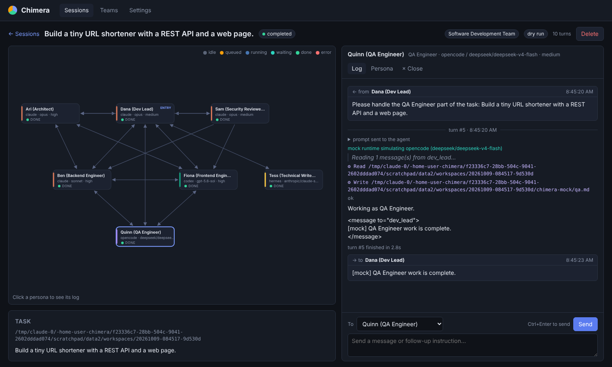
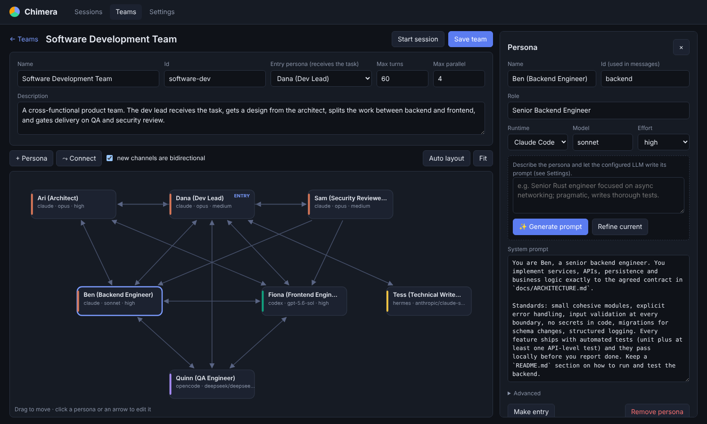
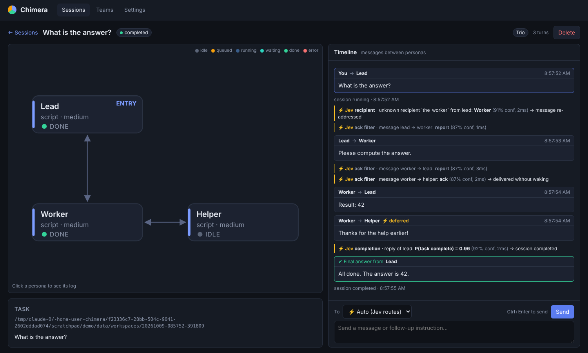

# Chimera

Chimera is a multi-agent orchestration harness written in Rust. It runs a **team of expert personas**, each
backed by a different agent CLI and model, and routes messages between them along a communication graph that
you define in the web UI.

- **Mixed runtimes**: Claude Code, OpenAI Codex CLI, opencode, GitHub Copilot CLI, Hermes Agent, pi, plus any CLI you describe in
  `chimera.yaml`. Each persona has its own model and effort level.
- **Team designer**: drag-and-drop graph editor for personas and communication channels (directed or
  bidirectional), with persona prompts generated by a configurable LLM API (DeepSeek by default).
- **Live sessions**: pick a team, give it a task, and watch the graph. Node colours show each agent's status
  and messages animate along the edges. Click a persona to see its live log: prompts, tool calls, output and
  messages.
- **Parallel sessions**: run as many sessions as you like at once, with the same team or different ones. Each
  session gets its own shared workspace directory, and agents within a session also run in parallel.
- **Quick decisions with Jev**: TypeSafe's decision model handles cheap routing calls between turns (about 100ms
  each) instead of running another agent turn: it skips turns for acknowledgements, fixes misaddressed messages,
  notices a missing `<final>`, and auto-routes your follow-ups.
- **Dry runs**: a built-in mock runtime simulates the whole team without calling any LLM, which is handy for
  checking a new graph.




## Install

Chimera runs on Linux and macOS. The crate is published as [`chimera-ai`](https://crates.io/crates/chimera-ai)
and installs a `chimera` command.

```bash
cargo install chimera-ai --locked     # build from source (Rust 1.88 or newer)
cargo binstall chimera-ai             # or download a prebuilt binary (needs cargo-binstall)
```

Prebuilt binaries for Linux (x86_64 and ARM, static) and macOS (Intel and Apple Silicon) are also attached to
each [GitHub Release](https://github.com/l0ngsight/chimera/releases): unpack the archive and put `chimera` on
your `PATH`.

## Quick start

```bash
chimera                        # web UI at http://127.0.0.1:7878
chimera tui                    # terminal UI (see below)
# options: --bind 0.0.0.0:7878 --data-dir ./data --config chimera.yaml
# (any address but 127.0.0.1 needs an access token: see "Access to the server")
# from a checkout: cargo run --release [-- tui]
```

On first start Chimera writes the sample teams to `data/teams/` (see [Sample teams](#sample-teams)).
Open the UI, choose the team, enter a task and press **Start session**. Tick **Dry run** to try it without any
agent CLIs installed.

Requirements: install and log in to the CLIs your personas use (`claude`, `codex`, `opencode`, `copilot`, `hermes`, `pi`). On Linux, also install bubblewrap (`bwrap`) so the process guard can keep agents away from your other programs.
**Settings → Agent runtimes** shows which of them are on the server's `PATH`. To generate persona prompts,
export the API key named in Settings (by default `DEEPSEEK_API_KEY`).

## Terminal UI

`chimera tui` runs the same workflow in the terminal: sessions list, new session (team, task, dry run), and a
live session view with every agent's status and log, messaging and cancel.

- If a Chimera server is already running at `--bind` (default `127.0.0.1:7878`), the TUI connects to it, and the
  web UI and TUI show the same sessions live. Otherwise it starts the server inside its own process (the web UI
  is then available too while the TUI runs; quitting asks for confirmation if sessions are still running, since
  they stop with it). Logs go to `data/chimera.log` so they don't scribble over the screen.
- `chimera tui --url http://host:7878` connects to a specific server and never starts one.

```
 ◐ Build a tiny URL shortener with a REST API   running
   Software Development Team · 6 turns · /home/me/chimera/data/workspaces/20261010-035317-06681a
╭ Agents ─────────────────────────────╮╭ Quinn (QA Engineer) — log ─────────────────────────────────╮
│ ☰  Timeline                         ││← from Dana (Dev Lead)  03:53:20                             │
│ ● Dana (Dev Lead) ENTRY             ││ ▏Please handle the QA part of the task: …                   │
│   waiting · claude/opus · medium    ││──── turn #5 · 03:53:20 ────                                 │
│▌● Quinn (QA Engineer)               ││▸ prompt (2930 chars) — p to show                            │
│   running · opencode/… · medium     ││⚙ bash npm test                                              │
╰─────────────────────────────────────╯╰─────────────────────────────────────────────────────────────╯
 ↑↓ agent   PgUp/PgDn scroll   End follow   m message   p prompts   c cancel   Esc back
```

| Screen | Keys |
|---|---|
| Sessions | `↑↓` select · `Enter` open · `n` new session · `r` refresh · `q` quit |
| New session | `↑↓` team · type or paste the task · `Ctrl+D` dry run · `Enter` start · `Esc` back |
| Session | `↑↓` timeline / agent log · `PgUp`/`PgDn`/`Home`/`End` scroll · `m` message (to the selected agent, or ⚡ auto / the entry from the timeline; `Tab` changes the recipient) · `p` show prompts · `c` cancel · `Esc` back |

## Sample teams

### Software Development Team

| Persona | Runtime | Model | Effort | Fallbacks on usage limits |
|---|---|---|---|---|
| Dana, Dev Lead (**entry**) | claude | opus | medium | claude sonnet high → codex gpt-5.5 high |
| Ari, Architect | claude | opus | high | |
| Ben, Backend Engineer | claude | sonnet | high | codex gpt-5.5 high |
| Fiona, Frontend Engineer | codex | gpt-5.6-sol | high | claude sonnet high |
| Quinn, QA Engineer | opencode | deepseek/deepseek-v4-flash | medium | |
| Sam, Security Reviewer | claude | opus | medium | |
| Tess, Technical Writer | hermes | anthropic/claude-sonnet-5-5 | low | |

The lead talks to everyone. The architect works with the engineers and security. Backend and frontend agree
API contracts directly. QA files bugs with both engineers, and security sends fix requests to the engineers
(one-way). See [`teams/software-dev.yaml`](teams/software-dev.yaml). Model names are free text: change them
in the editor to whatever your CLIs accept.

### Copilot Engineering Team

A second sample, [`teams/copilot-engineering-team.yaml`](teams/copilot-engineering-team.yaml), for an
environment where every agent must go through **GitHub Copilot CLI** with a fixed set of approved models. The
prompts are written for a regulated bank: small reviewable changes, tests with every change, no secrets or
customer data in code or logs, an audit trail, and a security & compliance gate before delivery.

| Persona | Model (context) | Effort | Why | Fallbacks |
|---|---|---|---|---|
| Priya, Dev Lead (**entry**) | gpt-5.4 (1.1M) | medium | holds the plan and every report; coordination needs judgement more than depth | gpt-5.6-luna → claude-sonnet-5 |
| Arjun, Architect | gpt-5.6-luna (1.1M) | high | strongest reasoning in the set; reads the whole codebase | claude-sonnet-5 → gpt-5.4 |
| Ben, Backend Engineer | gpt-5.3-codex (400K) | high | the coding-specialised model | claude-sonnet-5 → gpt-5.4 |
| Fiona, Frontend Engineer | claude-sonnet-5 (1M) | medium | strong UI work; most of it does not need high effort | gpt-5.3-codex → gpt-5.4 |
| Quinn, QA Engineer | gpt-5.4-mini (400K) | medium | many fast write-run-fix iterations, room for test logs | gpt-5-mini → gpt-5.4 (low) |
| Sam, Security & Compliance | claude-sonnet-5 (1M) | high | a different model family from the code's authors gives an independent review | gpt-5.6-luna → gpt-5.4 |
| Tara, Technical Writer | gpt-5-mini (192K) | low | documentation is high-volume and low-risk | gpt-5.4-mini |

All fallbacks stay on Copilot and the approved models, so a Copilot rate limit on one model (e.g. a weekly
per-model limit) moves the persona to another approved model. `max_parallel` is 3 to pace premium-request
usage. Log in once with `copilot` → `/login` (or set `COPILOT_GITHUB_TOKEN`) on the machine running Chimera.
Copilot restricts file access to the workspace and the temp directory, and unattended runs cannot approve URL access; add
`--allow-all-urls` or `--allow-url=…` to a persona's *Extra CLI arguments* if your policy permits network
access from agents.

Sample teams are written to `data/teams` once, also on existing installs when a new sample ships; deleting
one is permanent (`data/teams/.samples` records which were offered).

## How a session runs

1. The task is delivered to the team's **entry persona** as a message from the user.
2. The scheduler starts a turn for every persona with unread messages, up to the team's `max_parallel`.
3. A turn invokes the persona's CLI in the session workspace with a prompt containing the persona's prompt,
   team context, the original task, the teammates it may contact, and its new messages.
4. At the end of its turn, a persona addresses teammates with tags in its reply:

   ```
   <message to="backend">Implement POST /links per docs/ARCHITECTURE.md …</message>
   ```

   Messages are delivered only along edges of the graph. Undeliverable messages are shown in red and the sender
   is told about it on its next turn. If a persona fails, the personas waiting on it are notified.
5. The entry persona ends the session with `<final>…</final>`. A session also stops when there is no pending
   work (**idle**) or the turn budget (`max_turns`) runs out. You can always send a follow-up message to any
   persona from the session view to continue.

**Context between turns.** Claude personas keep a native CLI session (`--session-id` on the first turn and
`--resume` on later ones). For other runtimes Chimera replays the persona's earlier turns in the prompt,
within a size budget. Codex can be switched to native resume as well (see `chimera.example.yaml`).

**Editing a running team.** Saving a team in the editor also applies the change to existing sessions of that
team, from each persona's next turn (a turn already running finishes on the old settings). Each change appears in
the session timeline, e.g. "qa: model x → y". A persona that changes CLI starts a fresh CLI session and receives its
earlier conversation in the prompt; personas removed from the team stay in the session so its history remains
valid. Untick **apply to existing sessions** next to **Save team** to change only new sessions.

**Fallbacks on usage limits.** Each persona can list fallback runtime/model/effort combinations (team editor →
persona → *Fallbacks on usage limits*, or `fallbacks:` in the team YAML):

```yaml
  - id: architect
    runtime: claude
    model: opus
    effort: high
    fallbacks:                                   # tried in order
      - {runtime: claude, model: sonnet, effort: high}
      - {runtime: codex, model: gpt-5.5, effort: high}
```

When a turn fails because the CLI reports a usage, session or rate limit (Claude Code's "Usage limit reached ·
resets 3pm", Codex's "You've hit your usage limit. Try again in 4 days…", "429 Too Many Requests", "Quota
exceeded", …), Chimera:

1. records that runtime/model pair as limited until the reset time stated in the message (one hour if none is
   given). This is shared by all sessions, so other personas on the same pair go straight to their fallbacks
   instead of spending a turn on the limit;
2. re-delivers the turn's messages to the persona on its first fallback that is not limited. The failed attempt
   is not routed, its senders are not told about a failure, and it does not count against `max_turns`;
3. on every later turn, uses the first configuration that is not limited, so the persona returns to its primary
   once the limit has reset.

Switching to another CLI starts a fresh CLI session and replays the persona's earlier turns in the prompt. Each
switch appears in the timeline (↯), and the graph shows what the persona currently runs on. A persona with no
usable fallback left waits instead: its messages stay in its inbox, the session shows "waiting for usage limits to
reset", and the persona continues by itself when the earliest limit resets (with a hint to add a fallback if it has
none). `GET /api/limits` lists the current limits and `DELETE /api/limits?runtime=claude` forgets them, so
primaries are tried again on the next turn. Each runtime's
`limit_patterns` (case-insensitive phrases searched in a failed turn's error) can be overridden in
`chimera.yaml`.

**Workspace.** By default each session gets `data/workspaces/<session-id>`. You can also point a session at an
existing repository. All personas of a session share this directory.

## Quick decisions with Jev

Some orchestration steps need a judgement call, not an agent turn. Chimera hands these to
[Jev](https://docs.typesafe.ai), TypeSafe's "System One" model. Jev answers typed questions (choice or yes/no)
in about 100ms, at a small fraction of an LLM call's cost. Each decision appears in the session timeline with
its outcome, confidence, latency and cost.

| Decision | When | Effect |
|---|---|---|
| **Ack filter** | every teammate message | If Jev judges a message to be only an acknowledgement ("thanks", "sounds good"), it is delivered without starting a turn. The recipient reads it on its next turn. This stops thank-you ping-pong from spending Opus turns. |
| **Recipient repair** | `<message to="…">` names an id that is not on the team | Jev picks which allowed teammate was meant (or none). The message is re-addressed, but only along existing edges. |
| **Missed `<final>`** | the entry persona replies without `<final>` and nothing else is pending | If Jev is confident the reply hands the finished result to the user, the session completes with it. Otherwise it goes idle as before. |
| **Auto-routing** | you send a follow-up with recipient **⚡ Auto** | Jev picks the persona best suited to handle it, falling back to the entry persona. |
| **Effort advice** (optional, off by default) | before every turn | Jev picks the reasoning effort the turn's messages need, between `low` and the persona's configured effort (one level above it with *allow raise*). A quick rename runs at `low`, a design review keeps `high`. Turn it on in **Settings → Quick decisions** (`advise_effort`, `effort_min_confidence`, `effort_can_raise` in `chimera.yaml`). |

**Setup (OpenRouter, the default):** export your OpenRouter key as `JEV_API_KEY` (`OPENROUTER_API_KEY` also
works) for the server, then press **Settings → Quick decisions → Test connection**. Requests go to
OpenRouter's [System One API](https://openrouter.ai/docs/guides/community/typesafe-sdk)
(`https://openrouter.ai/api/v1/systemone`) and are billed to your OpenRouter account. `jev-latest` is routed to
`~typesafe/jev-latest`; set the model to e.g. `jev-1.13` to pin a version. To call TypeSafe directly instead,
pick the **TypeSafe direct** provider and set `TYPESAFE_API_KEY`.

**Local, with Ollama:** Ollama 0.35+ serves the same System One API at `/v1/systemone`. Run `ollama pull nimble`
(or the smaller `tev1` / `tev1:0.8b`), then pick the **Ollama (local)** provider in Settings: base URL
`http://localhost:11434/v1`, model `nimble`, no API key (leave the key variable empty; Chimera then never sends a
cloud key to it), 30-second timeout because the first call loads the model. Small local models report lower
confidence than Jev, so a decision may be skipped (and logged as not applied) where Jev would act; lower its
threshold in Settings if that happens often.

Each decision has its own switch and confidence threshold.
Decisions only adjust routing: if Jev is disabled, unreachable or unsure, Chimera behaves exactly as it would
without it. Dry runs never call Jev.



## Configuration

Copy `chimera.example.yaml` to `chimera.yaml` (Chimera reads `./chimera.yaml`, or the file given with
`--config`; `data/` is also relative to the current directory unless `--data-dir` says otherwise). Runtimes are
command templates. An entry with a built-in name is merged key by key over the built-in definition, so
`claude: {models: [opus]}` only changes the model list; a key you give replaces that whole value (giving
`args` replaces all arguments, including `--no-chrome` and the deny list, so copy them over when you do):

```yaml
runtimes:
  claude:
    command: claude
    args: [-p, ["--model", "{model}"], ["--effort", "{effort}"], ["--session-id", "{native_session}"],
           --output-format, stream-json, --verbose, --permission-mode, bypassPermissions]
    resume_args: [...]          # used once a native session exists
    session: preassign          # none | preassign | capture
    output: claude-stream-json  # text | claude-stream-json | codex-json | opencode-json
    effort_map: { minimal: low } # translate effort levels per CLI ("" drops the flag)
    timeout_secs: 3600
    limit_patterns: ["usage limit", "limit reached", "429", …]  # failed turns that switch to a fallback
    models_source: { kind: anthropic-api }   # where the persona editor gets the model list
    models: [opus, sonnet, haiku, fable]      # suggestions, and the fallback list
```

- Placeholders: `{model}`, `{effort}`, `{prompt}`, `{workdir}`, `{native_session}`. A nested list is an
  argument group that is dropped when one of its placeholders is empty, so an empty model omits `--model`.
- If no argument contains `{prompt}`, the prompt is sent on stdin.
- Personas can add `extra_args` and `env` (in the editor under *Advanced*).

Built-in defaults:

| Runtime | Invocation | Output parsing |
|---|---|---|
| `claude` | `claude -p --model M --effort E --output-format stream-json --verbose --permission-mode bypassPermissions --no-chrome --disallowedTools …` (prompt on stdin) | text, thinking, tool calls/results, cost |
| `codex` | `codex exec --model M -c model_reasoning_effort="E" --json --sandbox workspace-write --skip-git-repo-check -` (network on, approvals never) | agent messages, reasoning, commands, file changes |
| `opencode` | `opencode run --auto --model M --variant E --format json "<prompt>"` (`--auto` approves permission requests that are not explicitly denied; without it opencode auto-rejects them, e.g. access to `/tmp`) | text, reasoning, tool use |
| `hermes` | `hermes chat --model M -q "<prompt>"` | plain text |
| `pi` | `pi -p --mode json --model M --thinking E --session-id S` (prompt on stdin; the same `--session-id` continues the session) | text, thinking, tool calls/results, cost, errors and retries |
| `copilot` | `copilot --model M --reasoning-effort E --session-id S --output-format json --allow-all-tools --no-ask-user --no-auto-update --deny-tool=shell(pkill) …` (GitHub Copilot CLI; prompt on stdin; the same `--session-id` continues the session) | text, reasoning, tool calls/results, errors incl. `rate_limit`/`quota` |
| `mock` | built in | simulated delegation |

### Model lists

The persona editor's **Model** dropdown asks the selected CLI which models it can run. The list is cached for
10 minutes; **↻ refresh** fetches it again. Where the CLI reports supported reasoning efforts, the **Effort**
dropdown marks the ones the chosen model can't use.

| Runtime | Model list from (`models_source`) |
|---|---|
| `codex` | `codex debug models` (`kind: command, format: codex-catalog`): names, descriptions, context window and supported efforts |
| `opencode` | `opencode models --verbose` (`format: opencode-verbose`): every model of your configured providers, grouped by provider, with reasoning variants |
| `claude` | Claude Code has no list command: its aliases (`opus`, `sonnet`, …), plus every model id from the Anthropic Models API when `ANTHROPIC_API_KEY` is set on the server (`kind: anthropic-api`) |
| `hermes` | Only has an interactive picker, so the static `models` list (`kind: static`) |
| `pi` | `pi --list-models` (`format: pi-table`): models of every provider pi has credentials for, grouped by provider, with context size |

Any runtime can use `kind: command` with `format: lines` (one model id per line) to plug in its own listing
command. When fetching fails, the dropdown falls back to the static `models` and shows why. **Custom model id…**
always allows free text.

> The Claude invocation is verified end to end with real models; the pi invocation is verified end to end
> (pi 1.1.0, tool calls, session continuation) against a local OpenAI-compatible test server. The codex, opencode
> and hermes templates follow those CLIs' documented non-interactive modes, but flags change between versions. If one fails, the exact command line and
> stderr are in the persona's log, and you can adjust the template in `chimera.yaml` without rebuilding.

### Security

Agents run **unattended without permission prompts**, because nobody is there to approve them, on a computer
you may be using at the same time. Chimera layers these guardrails:

| Guardrail | Applies to | Enforced by |
|---|---|---|
| **Process guard**: the agent cannot send signals to programs it did not start (your browser, editors, the Chimera server), so it cannot kill or quit them, but it can still stop its own processes | every runtime (on macOS Codex uses its own sandbox) | **Linux**: private PID namespace via bubblewrap (`bwrap`), falling back to `unshare`; the agent cannot see other processes, and whatever it leaves running is stopped with it. The variables pointing at your desktop session are removed (`DISPLAY`, `WAYLAND_DISPLAY`, `DBUS_SESSION_BUS_ADDRESS`, `XDG_RUNTIME_DIR`, `TMUX`, `TMUX_PANE`, `STY`), so `xdotool`, `notify-send`, `systemctl --user` or `tmux kill-server` fail by default; an agent that deliberately sets them again can still reach those sockets. **macOS**: `sandbox-exec`, which also blocks Apple Events (AppleScript `quit`). Verified by a self-test at startup; status and switch in **Settings → Process guard** |
| Never kill, quit or restart programs it didn't start (browser, editors, the Chimera server); no killing by name or port; browser testing only in a headless browser with its own profile | every runtime | ground rules in every prompt |
| `pkill`, `killall`, `kill`, `… \| xargs kill`, `osascript`, `shutdown`, `reboot` are denied (also inside pipes and `&&` chains). These are prefix rules that catch the usual commands, not a boundary: `sh -c "pkill …"`, `/usr/bin/kill` or a script get through, which is what the process guard is for | Claude, Copilot | `--disallowedTools` (holds even with `bypassPermissions`); Copilot `--deny-tool` |
| No access to your real Chrome through Claude in Chrome | Claude | `--no-chrome` |
| Shell commands run in Codex's sandbox: writes confined to the workspace, network allowed, signals only within the sandbox | Codex | `--sandbox workspace-write` (macOS sandboxes can't be nested, so Codex uses its own instead of the process guard) |
| opencode approves its own permission requests (it can work outside the workspace, e.g. in `/tmp`) unless a rule denies them. To limit it, remove `--auto` from the opencode runtime in `chimera.yaml` and allow only what you want per persona, e.g. env `OPENCODE_CONFIG_CONTENT={"permission":{"external_directory":{"/tmp/**":"allow"}}}` | opencode | `--auto` |

The process guard is on by default and needs no configuration. On Linux it needs bubblewrap
(`sudo apt install bubblewrap` / `sudo dnf install bubblewrap`) or unprivileged user namespaces for `unshare`. If
its self-test fails, Settings says why and the new-session form shows a warning. It protects your running programs, not your files or
network: agents can still read and write anything your user can, reach any socket, and use the network. For full isolation, run
Chimera (and the CLIs) in a container, VM or separate OS user.

### Access to the server

The API can start agent processes in any directory, so only you should reach it. Every request is checked:

- **Host**: the `Host` header must be `localhost`, `127.0.0.1`, `[::1]`, the address Chimera listens on, or a name in
  `allowed_hosts`. This stops DNS rebinding (a web page making its own domain resolve to your machine).
- **Same origin**: requests that change something (POST, PUT, DELETE) from a page of another origin are refused, so a
  web page cannot start or cancel sessions in the background.
- **Token**: by default Chimera listens on `127.0.0.1` and needs no token. When it listens on any other address
  (`--bind 0.0.0.0:7878`), or when `auth_token` (or `CHIMERA_TOKEN`) is set, every request needs the token. Without a
  configured one, Chimera generates a token on first start, keeps it in `data/token`, and prints the URL to open:
  `http://<host>:7878/?token=…`. The browser keeps it in a cookie; the TUI takes `--token` or `CHIMERA_TOKEN`.

```yaml
auth_token: change-me            # or set CHIMERA_TOKEN
allowed_hosts: [chimera.lan]     # extra names the server is reached by
```

The token protects the API, not the traffic: Chimera speaks plain HTTP, so on an untrusted network put it behind a
TLS proxy or an SSH tunnel (`ssh -L 7878:localhost:7878 host`). From the settings page, API keys can only be read from
variables ending in `_API_KEY`; other names can be set in `chimera.yaml`.

### Environment variables

| Variable | Used for |
|---|---|
| `DEEPSEEK_API_KEY` (or the one named in Settings) | persona prompt generation |
| `JEV_API_KEY`, `OPENROUTER_API_KEY`, `TYPESAFE_API_KEY` | Jev quick decisions (the last two only for their own provider) |
| `ANTHROPIC_API_KEY` | listing every Claude model in the persona editor |
| `COPILOT_GITHUB_TOKEN`, `GH_TOKEN` | GitHub Copilot CLI login (read by `copilot`) |
| `CHIMERA_TOKEN` | API access token for the server and the TUI |
| `RUST_LOG` | log level, e.g. `chimera=debug` |

## Data layout

```
data/
  teams/<team-id>.yaml          # team definitions (edit in the UI or by hand)
  sessions/<id>/session.json    # status, team snapshot, agent states, inboxes, history
  sessions/<id>/events.jsonl    # full event log (replayed into the UI)
  workspaces/<id>/              # default shared working directory
  settings.yaml                 # prompt-LLM settings saved from the UI
```

Sessions survive restarts. A session that was running when the server stopped is marked **interrupted** and can
be resumed by sending it a message.

**Stopping.** Ctrl+C, `kill` (SIGTERM) or closing the terminal (SIGHUP) stops the agents, saves every session and
exits, normally within a second. A second Ctrl+C exits immediately, and the process exits after 8 seconds
whatever happens. Each agent runs in its own process group: a turn ends when the agent CLI exits, and anything it
left running in the background (a dev server, a file watcher) is stopped with it, so leftovers neither keep a
session "running" nor outlive Chimera. On Linux agents are also killed if Chimera itself is killed.

## HTTP API

| Method & path | Purpose |
|---|---|
| `GET /api/runtimes` | runtimes, availability, model suggestions |
| `GET /api/runtimes/{name}/models?refresh=` | models the runtime's CLI (or API) reports, cached for 10 minutes |
| `GET/POST /api/teams`, `GET/PUT/DELETE /api/teams/{id}` | team CRUD |
| `POST /api/personas/generate` | generate a persona prompt with the configured LLM |
| `GET/PUT /api/settings` | prompt-LLM and Jev settings (`{prompt_llm?, decisions?}`) |
| `POST /api/decisions/test` | send a minimal request to Jev |
| `GET/DELETE /api/limits?runtime=` | runtime/model pairs that hit a usage limit (personas use their fallbacks) / forget them |
| `GET/POST /api/sessions` | list / start sessions (`{team_id, task, title?, workdir?, dry_run?}`) |
| `GET/DELETE /api/sessions/{id}` | session summary and team snapshot / delete |
| `GET /api/sessions/{id}/stream` | server-sent events: full history, then live events |
| `GET /api/sessions/{id}/events?agent=ID` | event log, optionally for one persona |
| `POST /api/sessions/{id}/messages` | send `{to?, content}` (defaults to the entry persona; `"auto"` lets Jev route) |
| `POST /api/sessions/{id}/cancel` | stop running agents |

## Development

```bash
cargo test      # unit tests plus end-to-end orchestration tests (mock and process runtimes)
cargo clippy --all-targets
```

Source map: `model.rs` (teams/graph), `config.rs` (runtimes and LLM settings), `runtime.rs` (process
launching and output parsers), `orchestrator.rs` (scheduler, prompt building, message protocol, mock runtime),
`session.rs` (state, events, persistence), `decisions.rs` (Jev client and decision questions), `catalog.rs` (model lists from CLIs), `promptgen.rs` (persona prompt generation), `web.rs` (API and SSE),
`web/` (UI, embedded into the binary), `tui/` (terminal UI).

## License

[MIT](LICENSE)
